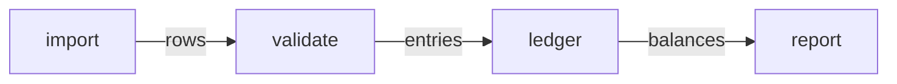

# Design Sketch — Hard Rules

Draw before code. Move boxes until shape is simple. No sketch = no design = always wrong.

Sister skills:

- `rex-code-priorities` — ranking that decides each trade-off in sketch.
- `rex-code-philosophy` — simplest shape, no speculative parts.
- `rex-mermaid-diagrams` — diagram syntax.
- `rex-code-folder-management` — tree that sketch must become.
- `rex-code-spike` — proves each unknown that sketch finds.
- `rex-code-validation-plan` — expected trace for each flow where order matters.
- `rex-code-improve-codebase-architecture` — deletion test (`.claude/skills/rex-code-improve-codebase-architecture/SKILL.md`, Three tests).

## Words

| Term | Meaning |
| --- | --- |
| Sketch | Module table + diagram + answers below. Part of `plan.md`. |
| Box | One module with one job. |
| Arrow | Data that moves from one box to other box. |
| Extension point | Place where system gets more of something with no edit to other boxes. |
| Pattern | Named arrangement of boxes. Example: pipeline, actors + one owner of state, ports + adapters, state machine. |
| Bandage | Box or branch that only hides a fault in other box. |
| Unknown | Part of sketch that works only IF an unproven fact is true. |

## Before sketch

- [ ] Read priority block (`rex-code-priorities`). IF missing, THEN send `STATUS: QUESTIONS` to caller.
- [ ] Read tree + entry files. IF feature, THEN find pattern that code already uses.
- [ ] Write in one line: result that work must give.

## SKETCH

Write these 6 parts in `plan.md`, in this order.

### 1. Module table

| Box | One job | State it owns | New / changed / same |
| --- | --- | --- | --- |
| `import` | Read supplier file, give rows | none | new |
| `ledger` | Hold balances, apply entries | balances | changed |

- [ ] One job for each box. IF job needs "and", THEN divide box or cut job.
- [ ] Each piece of state has one owner. Two owners = defect.
- [ ] Max 7 boxes in one sketch. IF more, THEN group boxes, or sketch is two features.
- [ ] Box name = domain word that will be module name.

### 2. Diagram

One Mermaid flowchart. Boxes from table. Arrows carry label: data that moves.



- [ ] Each arrow one direction. Two boxes with arrows both directions = find third box or merge.
- [ ] No cycle unless pattern needs it. IF cycle, THEN name why in one line.
- [ ] Mark each place where code waits, or work crosses thread, process, or network.

### 3. Pattern

- [ ] Name pattern in one line. IF you cannot name it, THEN sketch is pile of boxes. Draw again.
- [ ] IF repo already has pattern, THEN use it. New pattern needs reason from priority line.

### 4. Extension point

- [ ] Answer: what will there be more of? Take answer from priority line or task.
- [ ] Show which one box grows. Other boxes: no edit.
- [ ] IF nothing will grow, THEN write "none". Add no trait, no generic, no plug-in.
- [ ] Seam needs 2 adapters now. One adapter = no seam yet.

### 5. Fit (feature in existing code only)

- [ ] List existing code that must change shape so feature fits pattern.
- [ ] IF feature sits beside design with special case, THEN that is bandage. Change design instead.
- [ ] Give tree after work. It must obey `rex-code-folder-management`.

### 6. Unknowns

- [ ] List each unknown as yes/no question.
- [ ] Each unknown gets spike (`rex-code-spike`) before engineer builds on it.
- [ ] IF no unknown, THEN write "none".

## GATE: is sketch simple

```
FOR EACH box:
    Deletion test. IF complexity vanishes with box, THEN remove box.
    IF box only repairs output of other box, THEN bandage. Correct other box.
FOR EACH trade-off:
    Name quality from priority line that decided it.
IF simpler sketch gives same result, THEN use simpler sketch.
DO draw again UNTIL gate passes OR 3 rounds done.
```

- [ ] Reader can tell what system does from diagram alone.
- [ ] Sketch has nothing that task did not ask for.
- [ ] Each flow where order or time matters is on list for `rex-code-validation-plan`.
- [ ] Advisor or adversarial review reads sketch before code starts.

## Do not

- [ ] Do not write code in sketch. Signature of one interface = OK when it is extension point.
- [ ] Do not keep sketch as doc in repo. Tree + module `//!` lines carry design after build.
- [ ] Do not sketch for small fix that touches one function.

## Checklist

- [ ] Priority block read
- [ ] Module table: one job + one owner of state for each box
- [ ] One diagram, arrows labeled, one direction
- [ ] Pattern named
- [ ] Extension point named, or "none"
- [ ] Existing code reshaped, no bandage
- [ ] Unknowns listed as yes/no questions
- [ ] Gate passed, review done before code
